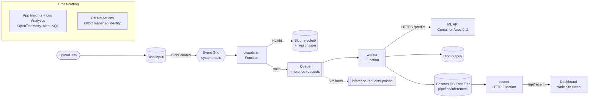

# Event-driven ML pipeline on Azure (Azure for Students)

ECE Paris, *Distributed Systems and AI* capstone 2026–2027. Team **`<team>`**: _member 1_, _member 2_, _member 3_.

When a CSV file lands in Blob Storage, the pipeline validates it, queues it, scores it with a
containerised ML API, stores the result and shows it on a live dashboard. Everything is
monitored, deployed from GitHub with no secrets, and kept within a few dollars.

## Architecture



| # | Service | What it does | Offer |
|---|---|---|---|
| 1 | Blob Storage `st<team>pipe` | `input/`, `output/`, `rejected/`, `models/`; versioning on | Standard LRS |
| 2 | Event Grid + **dispatcher** | BlobCreated, filtered on `/blobServices/default/containers/input/`; checks extension, size (≤ 1 MB), header and row count (≤ 1,000) | system topic |
| 3 | Storage queue | `inference-requests`, `maxDequeueCount = 5`, then `-poison` | included |
| 4 | **worker** | idempotent (id = sha256(blob + ETag), upsert), reused `httpx` client, 10 s timeout | Flex Consumption |
| 5 | ML API `api-<team>` | FastAPI `/health` `/version` `/predict` `/metrics` | Container Apps 0.25 vCPU / 0.5 GiB, 0 to 2 replicas |
| 6 | Blob `output/` | full JSON result per file | |
| 7 | Cosmos DB `cosmos-<team>` | metadata per file, partition key `/fileName` | Free Tier, 400 RU/s shared |
| 8 | Dashboard | `web/index.html` + Chart.js, refreshes every 30 s, calls **recent** | Blob static website |

All three functions live in **one** Python 3.12 Function App (`functions/function_app.py`, v2 model).

## Repository layout

```
model/      train.py, requirements.txt, model-1.0.0.joblib + .json (metrics, features)
api/        FastAPI app, tests (pytest), multi-stage Dockerfile
functions/  function_app.py (dispatcher, worker, recent), shared/validation.py, host.json, tests
web/        static dashboard (index.html, config.js written at deploy time)
infra/      deploy.sh: commented az script (check / foundation / eventgrid / outputs / cleanup)
samples/    demo files: valid, invalid schema, wrong extension, poison values
docs/       KQL queries, cost report, time log, screenshots/
.github/workflows/  ci.yml, deploy.yml
```

## Region choice

> **Region: `<region>`.** It appears both in the "Allowed resource deployment regions" policy of the
> integration subscription and in `az functionapp list-flexconsumption-locations`. Cosmos DB
> Free Tier was created there first, with the CLI, to check capacity early. _(Fill in after
> `./infra/deploy.sh check`, noting any region that failed.)_

## Dataset, task and model

- **Dataset**: Breast Cancer Wisconsin (Diagnostic), UCI ML Repository, **CC BY 4.0**
  (https://archive.ics.uci.edu/dataset/17). 569 rows, 30 numeric features. It ships with
  scikit-learn, so no download is needed.
- **Task**: binary classification, 1 = malignant, 0 = benign. Each uploaded CSV is a batch
  of patients, and the API returns a probability for each row.
- **Model**: `StandardScaler` + `LogisticRegression`, seed 42, stratified 80/20 split.
  To reproduce: `pip install -r model/requirements.txt && python model/train.py`.

| Metric (test set, 114 rows) | Model 1.0.0 | Naive baseline (majority class) |
|---|---|---|
| ROC AUC | **0.996** | 0.500 |
| F1 (malignant) | **0.951** | 0.000 |
| Accuracy | 0.965 | 0.632 |

Model file `model/model-1.0.0.joblib` is 2.2 KB. Single-row CPU inference takes about 0.05 ms,
well under the 1 s limit. The feature order and metrics are in `model/model-1.0.0.json`.

## API

```bash
curl https://<api-fqdn>/health
curl https://<api-fqdn>/version
curl -X POST https://<api-fqdn>/predict -H 'Content-Type: application/json' \
  -d "$(python3 -c "import csv,json;print(json.dumps({'records':list(csv.DictReader(open('samples/valid_batch.csv')))[:2]}))")"
```

```json
{"model_version":"1.0.0","api_version":"1.0.0","latency_ms":0.911,
 "predictions":[{"label":0,"class_name":"benign","probability":0.0004},
                {"label":1,"class_name":"malignant","probability":1.0}]}
```

- Pydantic validation: a missing field, missing feature or non-numeric value returns **422**.
- Tests (`api/tests`): success, invalid value (422), missing feature (422), missing body (422),
  empty list, `/health`, `/version`, `/metrics` counter.
- Image: multi-stage `python:3.12-slim`, non-root `appuser` (uid 10001), `HEALTHCHECK`,
  **491 MB** (CI fails above 500 MB). It is tagged `1.0.0`, `<commit sha>` and `latest` on GHCR.
- Container Apps: 0.25 vCPU / 0.5 GiB, `minReplicas 0`, `maxReplicas 2`, liveness and readiness
  probes on `/health`, configuration through environment variables only.
- Telemetry: `azure-monitor-opentelemetry`. Custom metrics are `inferences` (rows scored),
  `model_latency_ms` and `inference_errors`.

## Event-driven pipeline

**Example Event Grid event** (what the dispatcher receives):

```json
{
  "id": "3c1f…", "eventType": "Microsoft.Storage.BlobCreated",
  "subject": "/blobServices/default/containers/input/blobs/valid_batch.csv",
  "eventTime": "2026-11-24T14:02:11.123Z",
  "data": { "api": "PutBlob", "contentType": "text/csv", "contentLength": 2586,
            "eTag": "0x8DD0C6E2A1B2C3D", "blobType": "BlockBlob",
            "url": "https://st<team>pipe.blob.core.windows.net/input/valid_batch.csv" }
}
```

**Example queue message** (`inference-requests`):

```json
{"blobName": "valid_batch.csv", "eTag": "0x8DD0C6E2A1B2C3D", "size": 2586, "rows": 10,
 "eventTime": "2026-11-24T14:02:11.123000+00:00", "enqueuedAt": "2026-11-24T14:02:11.900000+00:00"}
```

**Validation (dispatcher)**: the file must end in `.csv`, be between 1 B and 1 MB, be UTF-8,
have a header with all 30 features, and have between 1 and 1,000 data rows. A rejected file is
copied to `rejected/<name>` (reason in the blob metadata) with a `rejected/<name>.reason.json`.

**Idempotency (worker)**: the document id is `sha256(blobName | ETag)`. If it already exists in
Cosmos DB, the message is acknowledged and skipped. Output blob and Cosmos DB writes are
`overwrite`/`upsert`, so a replay never duplicates. Re-uploading the same name with new content
gives a new ETag, so it is processed again.

**Failure scenario (poison)**: `samples/poison_values.csv` has a valid header but one cell is
`not-a-number`. The dispatcher only checks structure, so it queues the file. The API answers
**422**, and the worker raises so the runtime retries. After **5** dequeues, the message moves to
**`inference-requests-poison`**, which acts as the dead-letter queue. Each failure is logged
(`api_error` with `attempt`), and the error alert fires. To recover: fix the file and
re-upload it (new ETag), or move the message back to the main queue.

| Demo file | Expected result |
|---|---|
| `samples/valid_batch.csv` | `output/valid_batch.csv.json` plus a row on the dashboard in under a minute |
| `samples/invalid_schema.csv` | `rejected/` (missing column `mean_radius`) |
| `samples/invalid_extension.txt` | `rejected/` (extension not allowed) |
| `samples/poison_values.csv` | 5 attempts, then `inference-requests-poison`, then alert |

```bash
az storage blob upload --account-name st<team>pipe -c input -f samples/valid_batch.csv --auth-mode login
```

## Persistence and dashboard

- Cosmos DB for NoSQL, Free Tier: database `pipeline` (400 RU/s shared), container `inferences`,
  partition key `/fileName`. Each document has `id, fileName, timestamp, day, rows, prediction,
  positives, confidence, modelVersion, apiVersion, modelLatencyMs, apiCallMs, endToEndMs, attempt`.
- `GET /api/recent` returns the 20 latest documents. CORS is restricted to the static website
  origin (`az functionapp cors add`).
- Dashboard: `https://st<team>pipe.z<N>.web.core.windows.net/`. It shows 4 KPIs, a latency bar
  chart, a class doughnut chart and a table, refreshed every 30 s.

## Observability

- One Log Analytics workspace (`log-<team>`, **daily cap 0.2 GB**) and one workspace-based
  Application Insights resource (`appi-<team>`), both created explicitly in the project group.
  Both the API and the Function App send data to them.
- Custom metrics: API (`inferences`, `model_latency_ms`, `inference_errors`) and Functions
  (`pipeline_files` by outcome, `pipeline_api_latency_ms`, `pipeline_e2e_latency_ms`).
- Alert: `alert-pipeline-errors-<team>`, a log alert every 15 min that fires when there are more
  than 3 failed requests or exceptions, and emails through the action group.
- The 3 KQL queries (inferences per hour, 5 slowest files, HTTP codes and errors) are in
  [docs/kql.md](docs/kql.md). Screenshots are in `docs/screenshots/`.

## CI/CD and security

- **`ci.yml`** (push and PR): `ruff`, API and Functions `pytest`, then on push: build, push to
  GHCR (`:1.0.0`, `:<sha>`, `:latest`) and check the image size.
- **`deploy.yml`** (after CI succeeds on `main`, or manually): runs in the `production`
  environment, which needs a **required reviewer**. It logs in with `azure/login` using **OIDC**
  with the user-assigned managed identity `id-github-<team>` (Contributor on the resource group
  only). It then updates the Container App image, deploys the Function App (Flex, remote build),
  publishes the dashboard, and finally smoke-tests that `GET /version` reports the new commit.
- GitHub **secrets** hold identifiers only: `AZURE_CLIENT_ID`, `AZURE_TENANT_ID`,
  `AZURE_SUBSCRIPTION_ID`. **Variables**: `AZ_RESOURCE_GROUP`, `AZ_API_APP`, `AZ_FUNC_APP`,
  `AZ_STORAGE_ACCOUNT`.
- There are no keys or connection strings in the repo. The Function App uses its
  system-assigned identity (`AzureWebJobsStorage__accountName`, Cosmos DB data-plane RBAC). The
  App Insights connection string is set at deploy time as a Container Apps *secret*.
- The subscription owner makes the role assignments once, in `infra/deploy.sh foundation`,
  because the Contributor role cannot assign roles.

## Step-by-step deployment

Prerequisites: Azure CLI 2.9x signed in as the **owner** of the integration subscription,
GitHub repository (public), Docker optional.

```bash
cp infra/.env.example infra/.env   # team, region, GitHub repo, alert email
./infra/deploy.sh check            # allowed regions, Flex regions, register providers
./infra/deploy.sh foundation       # everything (Cosmos DB first), identities, roles, budget, alert
./infra/deploy.sh outputs          # values to put in GitHub
```

1. In GitHub, go to Settings → Secrets and variables → Actions. Add the 3 secrets and 4
   variables printed by `outputs`.
2. Go to Settings → Environments → `production`, then add a **required reviewer**.
3. Push to `main`. CI builds `ghcr.io/<account>/<repo>/api`. **Once only**: in the package
   settings, set its visibility to **Public** so that Container Apps can pull it without
   credentials.
4. Approve the `Deploy` run. This deploys the API, the functions and the dashboard.
5. Run `./infra/deploy.sh eventgrid`. The subscription needs the dispatcher to be deployed first.
6. Upload the files in `samples/` and watch the dashboard.

Private repository instead: change the federated subject to
`repo:<account>/<repo>:ref:refs/heads/main`, drop `environment: production`, and keep only the
`workflow_dispatch` trigger so a human starts each deployment.

## Azure for Students restrictions encountered

| Restriction | What we saw | What we did |
|---|---|---|
| Imposed regions | _fill in_ | single region checked against policy and Flex lists (`deploy.sh check`) |
| No Entra ID rights | cannot create a service principal | user-assigned managed identity with federated credential (OIDC) |
| ACR Tasks unavailable | (avoided) | image built in GitHub Actions and pushed to GHCR |
| Static Web Apps region policy | (avoided) | dashboard on Blob static website (`$web`) |
| 1 Container Apps environment | (avoided) | a single environment `cae-<team>` |
| Cosmos DB portal only shows EUAP | _fill in_ | created with the CLI in the project region |
| Contributor cannot assign roles | (avoided) | owner runs the role assignments once in `deploy.sh` |
| $100 shared credit | | $25 budget with 20/50/80 % alerts, capped logs, scale to zero, clean-up |
| Image size limit (brief) | first build was 810 MB | removed pandas, pip and test folders, so the image is 491 MB |

## Costs and clean-up

Estimate ≈ $0 to $1 for 15 days. Details, the actual D15 cost and the gap are in
[docs/cost-report.md](docs/cost-report.md). After the defence, run `./infra/deploy.sh cleanup`
(screenshots of `az group exists` = false and `az group list`).

## Local development

```bash
uv venv -p 3.12 .venv && uv pip install -p .venv -r api/requirements-dev.txt -r functions/requirements.txt
.venv/bin/ruff check .
(cd api && ../.venv/bin/pytest -q) && (cd functions && ../.venv/bin/pytest -q)
docker build -f api/Dockerfile -t ml-api . && docker run -p 8000:8000 ml-api
```

## Time log

See [docs/time-log.md](docs/time-log.md).
